# PASO 3: Datakit objetos


## Antes de instalar el Datakit

Es necesario instalar y seguir los pasos de este otro datakit, el cual contiene las conexiones

https://github.com/fatimafer/DC_connections.git  


## Instalar el Datakit

Abrimos en el navegador el Playground de Data 360 que hemos creado en las instrucciones del repositorio anterior.
Abrimos un terminal que tenga Salesforce CLI instalado, preferentemente en VSCODE.

Vamos a nuestro home o carpeta desde donde queramos trabajar.
```
cd ~
```

Clonamos el respositorio y nos situamos en la carpeta donde lo hemos clonado.
```
git clone https://github.com/fatimafer/DC_objects.git
```
```
cd DC_objects
```

Si estamos conectados a otras org de Salesforce en CLI, nos desconectamos.
```
sf org logout
```

Nos conectamos al playground creado en el paso anterior.
```
sf org login web -s -a coral-cloud
```

Testeamos primero el despliegue.
```
sf project deploy start --manifest manifest/package.xml --target-org coral-cloud --dry-run
```

Y si todo ha ido bien, desplegamos definitivamente
```
sf project deploy start --manifest manifest/package.xml --target-org coral-cloud
```


## Pasos posteriores


### Crear usuarios

* Pulsamos el engranaje de la parte superior derecha y seleccionamos Setup.

    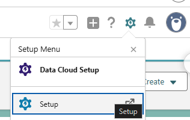


* En el buscador de la barra lateral izquierda buscamos Login Access Policies.
    Activamos la opción Administrators Can Log in as Any User.

    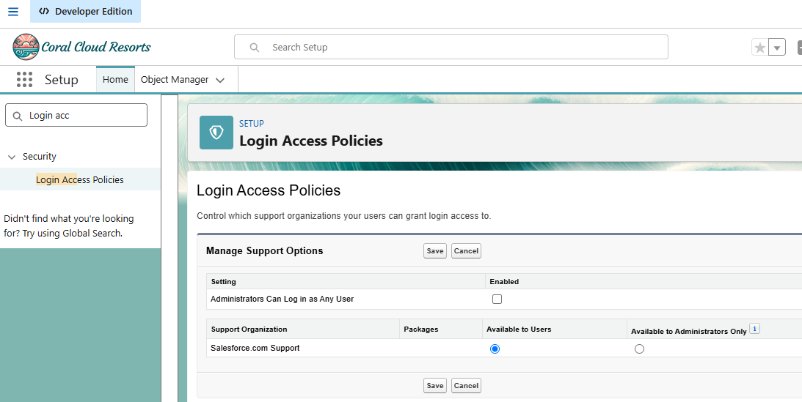


* En el buscador de la barra lateral izquierda buscamos Users y hacemos click en Users.
    Pulsamos el botón New User.

    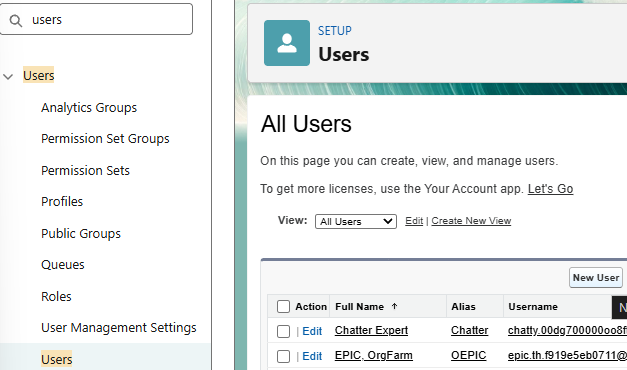


* Creamos dos usuarios. 
    1. Un usuario con el correo electrónico laura.smith@women-at-work.org. Este usuario pertenecerá al departamento de internacional y su licencia será Salesforce Platform y su perfil será Standard Platform User.
    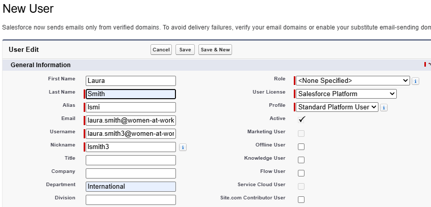

    2. Un usuario con el correo electrónico lana.evans@women-at-work.org. Este usuario pertenecerá al departamento de nacional y su licencia será Salesforce y su perfil será System Administrator.
    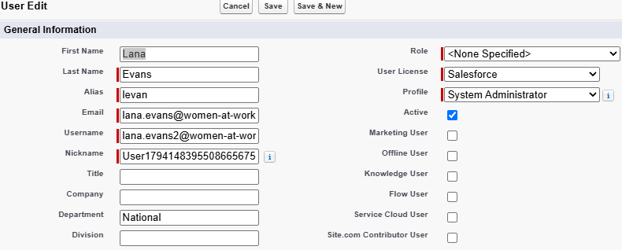    


* En la barra lateral izquierda volvemos al menú Users.
    Pulsamos el los dos usuarios creados.

    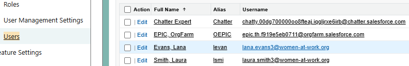


* Hacemos Scroll abajo y asignamos las siguientes licencias y permisos:
    Permission Set License Assignments: Data Cloud
    Permission Set Assignments: Data Cloud User

    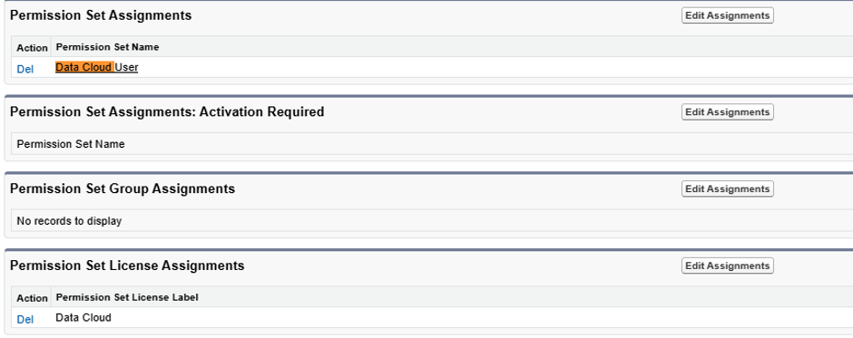


### Lanzar los Datastreams

* Vamos a la pestaña de Data Streams.

    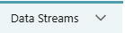


* Hacemos click en el botón con flecha de la parte derecha en los Data Streams que tengan el valor Active en la fila Data Stream Status y los valores None/Failed en la fila Last Run Status.
    Por ejemplo, en la imagen se lannzarían solo lo Session__c_Home y Experience__c_Home.

    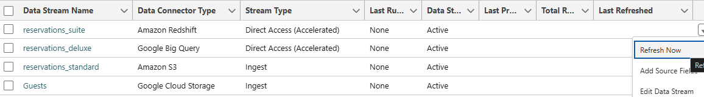

* Seleccionamos full refresh y hacemos click en Refresh Now.

    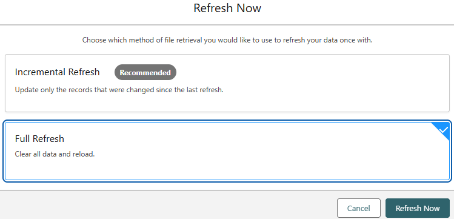

* Esperamos a que Last Run Status cambie a Success.

    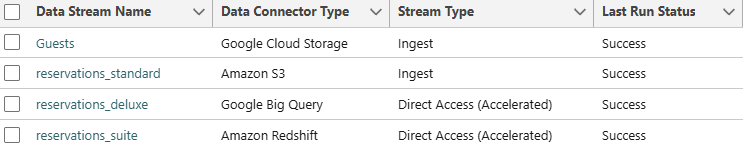


### Lanzar Data Transform

* Hacemos click en el botón Data Transforms.

    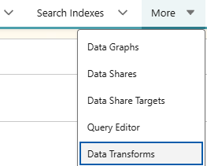

* Hacemos click en el botón con la flecha en la parte derecha y seleccionamos Run Now.

    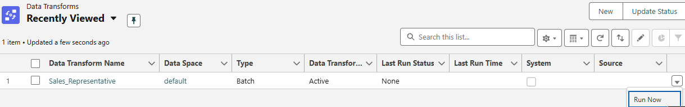

* Seleccionamos la opción Run with all Data y hacemos click en el botón Run.

    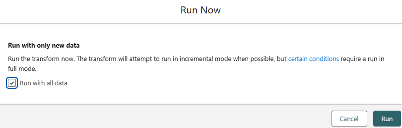    

* Esperamos a que el valor de la columna Last Run Status sea Success.

    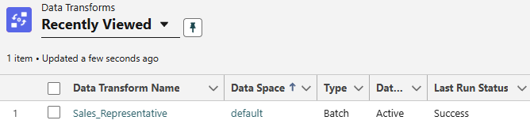            


### Lanzar Identity Resolution

* Vamos a la pestaña de Identity Resolution.

    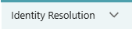


* Seleccionamos Resolution based on Email and name.

    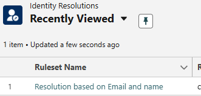


* Hacemos click en el botón superior derecho llamado Run Ruleset.

    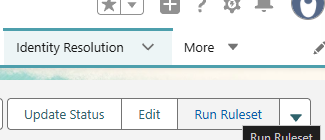


* Esperamos a que Last job Status estado cambie a Succeeded.

    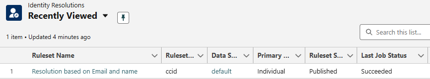


### Lanzar Calculated Insight

* Vamos a la pestaña de Calculated Insight.

    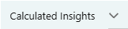


* En la flecha de la parte derecha hacemos click en Run now.

    


* Esperamos a que Last Run Status cambie a Success.

    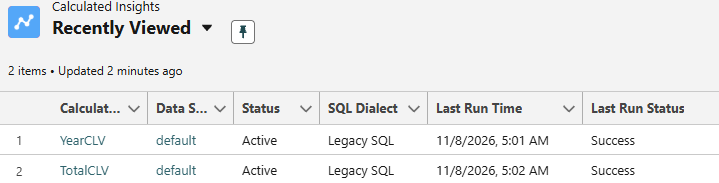


### Publicar segmentos

* Vamos a la pestaña de Segments.

    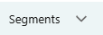

* Clickamos en el nombre de ambos segmentos: Experiences to discover y Vip Next season.

    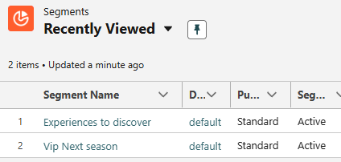


* Hacemos click en el botón flecha de la parte superior derecha y seleccionamos Publish Now.

    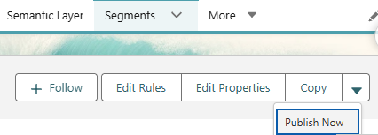

* Esperamos a que el valor de Publish Status de ambos segmentos sea Sucess.

    ![alt text](images/Publishstatus.png
    Los segmentos tardarán algo más en aparecer en las carpetas seleccionadas de las plataformas cloud.


## Si vemos errores, existe un bug Data Governance, policy All Data Access Ruleset

* Vamos a la pestaña de Data Governance.

    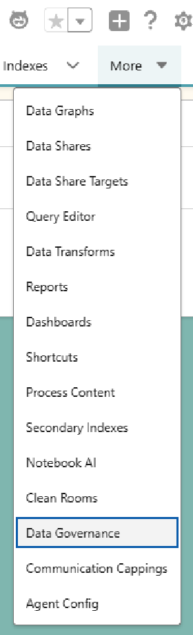

* Hacemos click en Policies.

    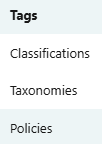

* Eliminamos All Data Access Ruleset.

    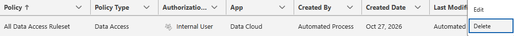

* En el botón superior derecho hacemos click en New.

    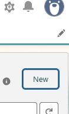

* En el panel izquierdo seleccionamos Data Access y después next.

    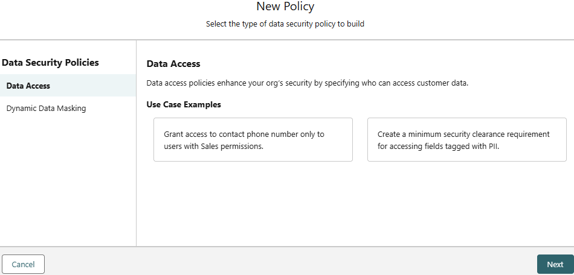

* Creamos una nueva policy que permita el acceso a todo seleccionando estas opciones.

    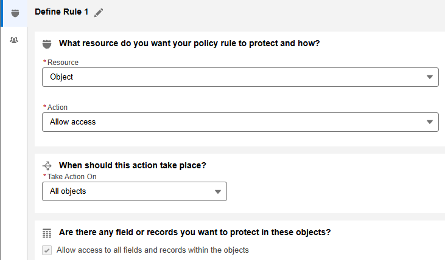
    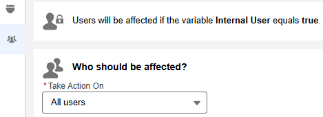


* Pulsamos el botón superior derecho que indica Save and activate.

    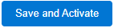